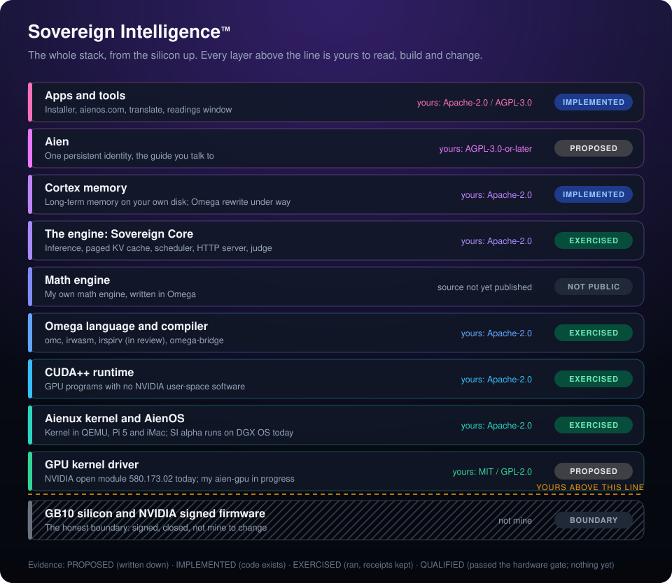

<div align="center">

# Sovereign Intelligence™ (SI)

**My own AI, on hardware I own, with every layer open to read, rebuild and change.**

Sovereign Intelligence, built on [AienOS](https://github.com/aien-dev/AienOS-nv).

```sh
curl -fsSL https://aienos.com/install.sh | sh
```

[Install](#install) · [The stack](#the-stack-and-whats-yours) · [Every repository](#every-repository) · [Deeper walk](docs/STACK.md) · [Naming](NAMING.md) · [aienos.com](https://www.aienos.com)

</div>

<br>

<p align="center">
  
</p>

<br>

## Install

On an NVIDIA DGX Spark (Linux arm64, GB10, kernel driver 580.173.02):

```sh
curl -fsSL https://aienos.com/install.sh | sh
```

It checks the machine first (anything else gets a friendly note and nothing changes), downloads release alpha-20261026.1 by exact tag, verifies the Ed25519 signature of SHA256SUMS (alpha key ff949504…f54a, see [KEYS](KEYS)) and every SHA-256 before unpacking, installs into ~/.local/share/aienos (no sudo), and opens the Omega wizard. Remove everything with `aienos uninstall`.

Check a release by hand:

```sh
openssl pkeyutl -verify -pubin -inkey release.pub.pem -rawin -in SHA256SUMS -sigfile SHA256SUMS.sig && sha256sum -c SHA256SUMS
```

**Evidence:** installer EXERCISED (host 33/33 under read-only root, container 6/6); engine commit cf239078 passed SC-GB10-SERVE-CHAT once; this binary on a GPU and a first token via the installer: NOT_RUN; the Allen experience is not in this release yet.

<br>

## The stack, and what's yours

Every layer above the silicon is source you can read, build and change. The bottom layer is the honest boundary: NVIDIA's signed firmware runs on the GB10 and I cannot change it, so I say so.

| | Layer | Yours: license and source | What you can change |
| :---: | :--- | :--- | :--- |
| 10 | **Apps and tools** | Apache-2.0 WITH LLVM-exception or AGPL-3.0, per repository: [installer](https://github.com/aien-dev/sovereign-intelligence), [aienos.com](https://github.com/aien-dev/aienos.com), [aien-translate](https://github.com/aien-dev/aien-translate) | Anything. The installer is Omega you can read before you run it. |
| 9 | **Allen** | AGPL-3.0: [allen](https://github.com/aien-dev/allen) | His identity, memory and voice contracts. |
| 8 | **Cortex memory** | Apache-2.0: [cortex-rs](https://github.com/aien-dev/cortex-rs) today, rewritten in Omega in [cortex](https://github.com/aien-dev/cortex) | What is remembered, where it is stored, when it is forgotten. |
| 7 | **The engine: Sovereign Core** | Apache-2.0: [aien-sovereign-core-mv](https://github.com/aien-dev/aien-sovereign-core-mv) | Scheduling, KV cache, serving and the test judge. |
| 6 | **Math engine** | My own engine, written in Omega. Source not yet published. | Nothing yet; it will be yours when it is published. |
| 5 | **Omega language and compiler** | Apache-2.0: [omega-mv](https://github.com/aien-dev/omega-mv), [omega-bridge](https://github.com/aien-dev/omega-bridge) | The language itself: omc, irwasm, irspirv (merged, CPU-exercised; not run on GPU / DPC++). |
| 4 | **CUDA++ runtime** | Apache-2.0: [CUDApp](https://github.com/aien-dev/CUDApp) | Instruction encoder, runtime and kernels, with no NVIDIA user-space software. |
| 3 | **Aienux kernel and AienOS** | Apache-2.0: [aienux](https://github.com/aien-dev/aienux), [AienOS-nv](https://github.com/aien-dev/AienOS-nv) | The kernel and the OS. SI alpha still runs on the Spark's own Linux. |
| 2 | **GPU kernel driver** | Today NVIDIA's open kernel module 580.173.02 (Dual MIT/GPL). Mine, aien-gpu, is being written in [CUDApp](https://github.com/aien-dev/CUDApp/blob/main/omega/slices/kmod.osc) (Dual MIT/GPL-2.0). | NVIDIA's module source is open; aien-gpu will replace it. |
| 1 | **GB10 silicon and NVIDIA signed firmware** | Not mine. | Nothing. This is the boundary, stated plainly. |

Evidence words mean one thing each: **PROPOSED** (written down), **IMPLEMENTED** (code exists), **EXERCISED** (ran, with kept receipts), **QUALIFIED** (passed the hardware gate). Nothing is QUALIFIED yet. The walk down the stack, layer by layer, is in [docs/STACK.md](docs/STACK.md).

<br>

## Every repository

Every public repository in [aien-dev](https://github.com/aien-dev), grouped by layer. This section and [index/repos.json](index/repos.json) are rebuilt every hour from GitHub by an Omega program; the layer, purpose and evidence come from the hand-curated [index/curated.yml](index/curated.yml).

<!-- index:begin (generated by index/gen/index.om; edit index/curated.yml instead) -->

61 public repositories in [aien-dev](https://github.com/aien-dev): 41 active, 20 archived. Machine-readable: [index/repos.json](index/repos.json).

### Silicon, firmware and boot

The GB10 and NVIDIA's signed firmware are the boundary I do not own. Above it, the boot chain is mine.

| Repository | What it is | Evidence | License | Last push |
| :--- | :--- | :---: | :--- | :--- |
| [atlas](https://github.com/aien-dev/atlas) | A 1.5 KB AArch64 boot seed that refuses any next stage whose SHA-256 does not match | `EXERCISED` | Apache-2.0 | 2026-10-26 |
| [edk2-non-osi](https://github.com/aien-dev/edk2-non-osi) | Mirror of EDK II non-OSI binaries for the Pi 5 chain *(fork)* | `n/a` | none | 2026-10-25 |
| [rpi5-uefi](https://github.com/aien-dev/rpi5-uefi) | Raspberry Pi 5 UEFI build, submodules pointed at my mirrors *(fork)* | `n/a` | none | 2026-10-25 |

### Kernel and operating system

Aienux, the kernel, and AienOS, the operating system SI is built on.

| Repository | What it is | Evidence | License | Last push |
| :--- | :--- | :---: | :--- | :--- |
| [aienix](https://github.com/aien-dev/aienix) | Older front door that pins the main components as submodules | `PROPOSED` | AGPL-3.0-or-later | 2026-10-26 |
| [AienOS-nv](https://github.com/aien-dev/AienOS-nv) | AienOS's own home: what the OS layer is and how to get it through SI | `n/a` | Apache-2.0 WITH LLVM-exception | 2026-10-26 |
| [aienux](https://github.com/aien-dev/aienux) | Aienux, the AienOS kernel: boot, scheduling, IPC and capabilities. Pre-alpha, not in the alpha bundle | `EXERCISED` | Apache-2.0 | 2026-10-26 |

### CUDA++ runtime

GPU programs with no NVIDIA user-space software.

| Repository | What it is | Evidence | License | Last push |
| :--- | :--- | :---: | :--- | :--- |
| [CUDApp](https://github.com/aien-dev/CUDApp) | CUDA++: my GPU runtime, instruction encoder and kernels for GB10; home of the aien-gpu driver work | `EXERCISED` | Apache-2.0 WITH LLVM-exception | 2026-10-26 |
| [physics-mv](https://github.com/aien-dev/physics-mv) | FORGE: request-bound machine realization, a native GB10 client over the open ioctls, boot gates | `EXERCISED` | Apache-2.0 WITH LLVM-exception | 2026-10-26 |

### Omega language and compiler

The language everything moves into: omc, irwasm, irspirv, and libraries written in it.

| Repository | What it is | Evidence | License | Last push |
| :--- | :--- | :---: | :--- | :--- |
| [omega-bridge](https://github.com/aien-dev/omega-bridge) | Emits checked C and Python from a bounded .om subset, so other languages can call Omega | `EXERCISED` | Apache-2.0 WITH LLVM-exception | 2026-10-26 |
| [omega-harness](https://github.com/aien-dev/omega-harness) | Skills that teach agents to write Omega and label evidence honestly | `IMPLEMENTED` | Apache-2.0 | 2026-10-26 |
| [omega-mv](https://github.com/aien-dev/omega-mv) | Omega: seeded .om compiler, backends, GB10 kernels, specs and gates. [irspirv](https://github.com/aien-dev/omega-mv/blob/3a10bd29fb7debdcf2c8f5cb58680cc74cb5b1f3/docs/SPIRV.md): CPU-exercised ([receipt](https://github.com/aien-dev/omega-mv/blob/3a10bd29fb7debdcf2c8f5cb58680cc74cb5b1f3/evidence/IRSPIRV/20261026-4ad014ed3/receipt.json)); not run on GPU / DPC++. | `EXERCISED` | Apache-2.0 | 2026-10-26 |
| [omnet](https://github.com/aien-dev/omnet) | Security-critical network and crypto code rewritten in Omega | `EXERCISED` | Apache-2.0 | 2026-10-26 |

### The engine: Sovereign Core

Inference, scheduling, evidence and the measurements behind every claim.

| Repository | What it is | Evidence | License | Last push |
| :--- | :--- | :---: | :--- | :--- |
| [aegis-runtime-mv](https://github.com/aien-dev/aegis-runtime-mv) | Agent runtime: WebSocket, SSE and REST gateway, heartbeats, workflow DAG | `EXERCISED` | AGPL-3.0-or-later | 2026-10-26 |
| [aien-receipts](https://github.com/aien-dev/aien-receipts) | Append-only signed verification receipts by repository and commit | `EXERCISED` | Apache-2.0 | 2026-10-26 |
| [aien-sovereign-core-mv](https://github.com/aien-dev/aien-sovereign-core-mv) | Sovereign Core: the aien runtime, paged KV cache, scheduler, HTTP server and test judge | `EXERCISED` | Apache-2.0 | 2026-10-26 |
| [aien-train](https://github.com/aien-dev/aien-train) | Plan for training my own language model on my own engine | `PROPOSED` | AGPL-3.0-or-later | 2026-10-25 |
| [benchmarks-mv](https://github.com/aien-dev/benchmarks-mv) | Measurement harnesses and evidence bundles for GB10 | `EXERCISED` | Apache-2.0 | 2026-10-26 |
| [spark-rsi-mv](https://github.com/aien-dev/spark-rsi-mv) | Self-improvement loop with a separate judge, a signed ledger and a promotion gate | `EXERCISED` | AGPL-3.0-or-later | 2026-10-26 |
| [spark-supervisor](https://github.com/aien-dev/spark-supervisor) | Process supervisor with health polls and restart backoff | `IMPLEMENTED` | Apache-2.0 WITH LLVM-exception | 2026-10-26 |

### Cortex memory

Long-term memory that stays on your machine.

| Repository | What it is | Evidence | License | Last push |
| :--- | :--- | :---: | :--- | :--- |
| [cortex](https://github.com/aien-dev/cortex) | Cortex memory server being rewritten in Omega (work in progress, branch wip/omega-cortex); parity with cortex-rs not yet run; live Cortex is still cortex-rs | `IMPLEMENTED` | Apache-2.0 | 2026-10-26 |

### Allen

One persistent identity across my machines.

| Repository | What it is | Evidence | License | Last push |
| :--- | :--- | :---: | :--- | :--- |
| [allen](https://github.com/aien-dev/allen) | Allen: plans for one persistent identity across the iMac, Pi, Spark and MacBook | `PROPOSED` | AGPL-3.0-or-later | 2026-10-26 |
| [omega-projects](https://github.com/aien-dev/omega-projects) | Projects built with Allen; I review each before it goes live | `IMPLEMENTED` | Apache-2.0 WITH LLVM-exception | 2026-10-26 |

### Apps, tools and the front door

What you touch: the installer, the site, and tools built on the stack.

| Repository | What it is | Evidence | License | Last push |
| :--- | :--- | :---: | :--- | :--- |
| [agent-archive](https://github.com/aien-dev/agent-archive) | Turns Claude, Codex, OpenCode, Gemini and Muse chat logs into one JSONL archive | `IMPLEMENTED` | AGPL-3.0-or-later | 2026-10-26 |
| [aien-edge](https://github.com/aien-dev/aien-edge) | Static-site server with brotli and ACME; parked, never deployed | `IMPLEMENTED` | AGPL-3.0-or-later | 2026-10-25 |
| [aien-rig](https://github.com/aien-dev/aien-rig) | Plan for local AI and frame-rate tuning on RTX gaming PCs | `PROPOSED` | AGPL-3.0-or-later | 2026-10-25 |
| [aien-translate](https://github.com/aien-dev/aien-translate) | translate.js server backed by my own local model, no API key | `IMPLEMENTED` | AGPL-3.0-or-later | 2026-10-26 |
| [aienos.com](https://github.com/aien-dev/aienos.com) | Source of aienos.com, deployed by GitHub Pages; a rewrite generated by seeded Omega is a draft (aienos.com#122), not deployed | `EXERCISED` | Apache-2.0 WITH LLVM-exception | 2026-10-26 |
| [mobhub](https://github.com/aien-dev/mobhub) | Faction operations tool for Torn City; a side project outside AienOS | `IMPLEMENTED` | Apache-2.0 WITH LLVM-exception | 2026-10-26 |
| [open-humanity](https://github.com/aien-dev/open-humanity) | Opt-in, privacy-first assistance network and volunteer compute | `PROPOSED` | Apache-2.0 | 2026-10-26 |
| [pi-register](https://github.com/aien-dev/pi-register) | Register of what a Linux server runs and why | `IMPLEMENTED` | AGPL-3.0-or-later | 2026-10-25 |
| [readings-window](https://github.com/aien-dev/readings-window) | Read-only, token-gated window onto the Spark's GPU and CPU readings | `EXERCISED` | AGPL-3.0-or-later | 2026-10-26 |
| [sovereign-intelligence](https://github.com/aien-dev/sovereign-intelligence) | This repo: the front door, the one-command installer and signed releases | `n/a` | Apache-2.0 WITH LLVM-exception | 2026-10-26 |
| [spark-connector](https://github.com/aien-dev/spark-connector) | Plan for a volunteer DGX Spark verification connector | `PROPOSED` | AGPL-3.0-or-later | 2026-10-26 |
| [t3code](https://github.com/aien-dev/t3code) | Fork of t3code with one pending contribution (message reactions) *(fork)* | `IMPLEMENTED` | MIT | 2026-10-18 |
| [translate](https://github.com/aien-dev/translate) | Preserved translate.js fork with pinned publish Actions *(fork)* | `n/a` | MIT | 2026-10-26 |

### Design, protocols and proof

The specs, decisions and protocols the layers agree on.

| Repository | What it is | Evidence | License | Last push |
| :--- | :--- | :---: | :--- | :--- |
| [.github](https://github.com/aien-dev/.github) | Organization profile, Constitution, Covenant and contribution guidance | `n/a` | Apache-2.0 | 2026-10-26 |
| [aien-architecture-mv](https://github.com/aien-dev/aien-architecture-mv) | How it all fits: ADRs, doctrine, plans, gates and crumb tools | `PROPOSED` | AGPL-3.0-or-later | 2026-10-26 |
| [aien-protocols-mv](https://github.com/aien-dev/aien-protocols-mv) | Wire formats and schemas with test vectors and checkers | `EXERCISED` | Apache-2.0 | 2026-10-26 |
| [interplane-mv](https://github.com/aien-dev/interplane-mv) | INTERPLANE: an open protocol between models and agent runtimes | `EXERCISED` | Apache-2.0 | 2026-10-26 |
| [interplane.io](https://github.com/aien-dev/interplane.io) | Source of interplane.io | `IMPLEMENTED` | AGPL-3.0-or-later | 2026-10-25 |
| [synapse](https://github.com/aien-dev/synapse) | Agent-native signed changesets with Git and Radicle interop | `EXERCISED` | Apache-2.0 | 2026-10-26 |

<details>
<summary><b>Archived (20)</b>: read-only history, kept for the record</summary>

| Repository | What it is | Evidence | License | Last push |
| :--- | :--- | :---: | :--- | :--- |
| [aien-harness](https://github.com/aien-dev/aien-harness) | MCP harness with schema checks and failure replay; now in Core | `IMPLEMENTED` | Apache-2.0 WITH LLVM-exception | 2026-10-26 |
| [aien-local-stack](https://github.com/aien-dev/aien-local-stack) | One-process composition of the agent runtime and Core | `EXERCISED` | Apache-2.0 WITH LLVM-exception | 2026-10-26 |
| [aien-yardsticks](https://github.com/aien-dev/aien-yardsticks) | Outside reference oracles I measured against | `IMPLEMENTED` | AGPL-3.0-or-later | 2026-10-26 |
| [arm-trusted-firmware](https://github.com/aien-dev/arm-trusted-firmware) | Mirror of Trusted Firmware-A for the Pi 5 chain *(fork)* | `n/a` | NOASSERTION | 2026-10-15 |
| [cortex-rs](https://github.com/aien-dev/cortex-rs) | The first Cortex memory server, SQLite FTS5 plus vectors; still the live Cortex | `IMPLEMENTED` | Apache-2.0 WITH LLVM-exception | 2026-10-26 |
| [crumb-spec-mv](https://github.com/aien-dev/crumb-spec-mv) | The Crumb protocol spec and a hash-chained ledger | `PROPOSED` | Apache-2.0 WITH LLVM-exception | 2026-10-26 |
| [edk2](https://github.com/aien-dev/edk2) | Mirror of EDK II for the Pi 5 firmware chain *(fork)* | `n/a` | NOASSERTION | 2026-10-15 |
| [edk2-platforms](https://github.com/aien-dev/edk2-platforms) | Mirror of edk2-platforms for the Pi 5 chain *(fork)* | `n/a` | NOASSERTION | 2024-03-15 |
| [encounter](https://github.com/aien-dev/encounter) | Research commons idea; README only | `PROPOSED` | none | 2026-10-13 |
| [harvester](https://github.com/aien-dev/harvester) | Pulled reasoning traces into datasets; now in Core | `IMPLEMENTED` | Apache-2.0 WITH LLVM-exception | 2026-10-26 |
| [MojoLlama](https://github.com/aien-dev/MojoLlama) | CPU inference engine in Mojo and C; dropped with Mojo and MAX | `EXERCISED` | Apache-2.0 | 2026-10-26 |
| [odysseus](https://github.com/aien-dev/odysseus) | Fork of a self-hosted AI workspace with a stable prompt prefix *(fork)* | `IMPLEMENTED` | AGPL-3.0 | 2026-10-14 |
| [physics0](https://github.com/aien-dev/physics0) | Retired and empty; the learner moved into Omega | `n/a` | Apache-2.0 | 2026-10-03 |
| [rad-id-sync](https://github.com/aien-dev/rad-id-sync) | Fingerprints SSH and Radicle keys into one identity record | `IMPLEMENTED` | Apache-2.0 WITH LLVM-exception | 2026-10-26 |
| [spark-adapters](https://github.com/aien-dev/spark-adapters) | Provider router and verifier; now in Core | `IMPLEMENTED` | Apache-2.0 WITH LLVM-exception | 2026-10-26 |
| [spark-crumbs-mv](https://github.com/aien-dev/spark-crumbs-mv) | Older crumb ledger CLI | `IMPLEMENTED` | Apache-2.0 WITH LLVM-exception | 2026-10-26 |
| [spark-debugger](https://github.com/aien-dev/spark-debugger) | Service watchdog with an incident log | `IMPLEMENTED` | Apache-2.0 WITH LLVM-exception | 2026-10-26 |
| [spark-dream](https://github.com/aien-dev/spark-dream) | Idle-time daemon that wrote notes into Cortex | `IMPLEMENTED` | Apache-2.0 WITH LLVM-exception | 2026-10-26 |
| [spark-hive](https://github.com/aien-dev/spark-hive) | Hex-grid event store and plan generator | `IMPLEMENTED` | Apache-2.0 WITH LLVM-exception | 2026-10-26 |
| [spark-inquisitor](https://github.com/aien-dev/spark-inquisitor) | Diff auditor for telemetry, secrets and banned wording | `IMPLEMENTED` | Apache-2.0 WITH LLVM-exception | 2026-10-26 |

</details>

<!-- index:end -->

<br>

## How the index stays current

- [index/gen/index.om](index/gen/index.om) is the generator, written in Omega and compiled with the pinned omc.
- The [index-sync](.github/workflows/index-sync.yml) workflow runs hourly, on demand, and on a `repository_dispatch` of type `index-sync`. It opens one pull request labelled `automerge`, which merges only after the `index-check` job passes. Until the organization lets Actions open pull requests, it pushes the `bot/index-sync` branch and a person opens the pull request.
- A public repository with no entry in [index/curated.yml](index/curated.yml) makes the generator fail with exit 1 and name it. Nothing goes missing silently.
- **Rule for every change:** when a repository's purpose, status or links change, or a new repository appears, update its entry in index/curated.yml in the same piece of work.

<br>

## More

- [What I am building](docs/WHAT-I-AM-BUILDING.md): every repository, what it really does, and how far it has got
- [About the engineer](https://www.aienos.com/engineer/)
- [Naming](NAMING.md): how to write Sovereign Intelligence (SI) and AienOS
- [NOTICE](NOTICE) and [LICENSE](LICENSE): Apache-2.0 WITH LLVM-exception

<br>

<sub>"Sovereign Intelligence" and "SI" are trademarks of Drake Stapleton. NVIDIA, CUDA and GB10 are trademarks of NVIDIA Corporation.</sub>
